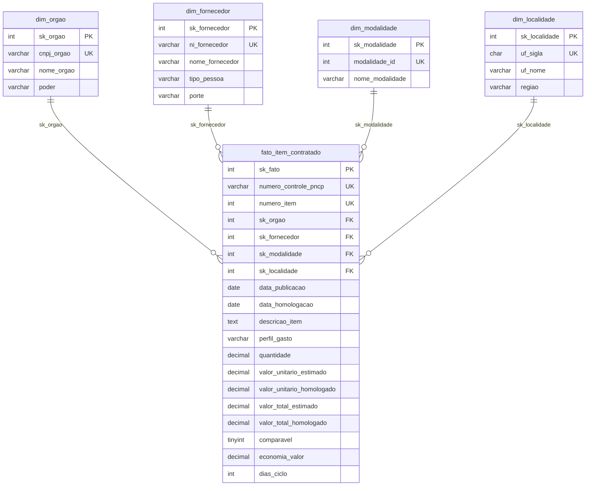

# Projeto Final – Módulo 2: Esteira Analítica de Contratações Públicas (PNCP 2025)

## 1. Contexto do problema

A Controladoria identificou gargalos operacionais severos nas compras e contratações públicas federais:

- **Indícios de sobrepreço** em itens homologados, com valores pagos acima do estimado.
- **Concentração atípica de contratos** em determinados grupos econômicos.
- **Morosidade** entre a publicação dos editais e o fechamento dos certames.
- **Baixa adesão competitiva** em certas modalidades de licitação.

O cenário se agrava porque os sistemas legados de onde os dados são extraídos não possuem travas de validação na entrada. O repositório bruto reúne anomalias como identificadores (CNPJ/CPF) corrompidos, valores monetários preenchidos em texto livre, inconsistências de cronograma (homologação anterior à publicação do edital), formatos de data despadronizados, nulos disfarçados e textos com a codificação quebrada. Por isso, a liderança governamental não confia nos relatórios gerados diretamente dessa base e não consegue decidir ou auditar com segurança.

Este projeto responde a esse problema com uma esteira analítica ponta a ponta, que transforma os dados brutos em um ambiente confiável, auditável e voltado à decisão executiva:

```
CSVs brutos (PNCP) → Python (auditoria + limpeza) → MySQL (Star Schema) → Power BI (dashboard)
```

O trabalho foi desenvolvido no papel de analista de dados de uma consultoria de inteligência governamental que atende órgãos de controle e transparência pública.

### Base de dados

Os dados vêm do Portal Nacional de Contratações Públicas (PNCP) e abrangem contratações de órgãos federais publicadas em 2025, de 02/01/2025 a 31/12/2025 (12 meses consecutivos), usadas por inteiro. A extração já foi feita e os arquivos estão em `data/raw/`. Trata-se de uma amostra ao longo do ano, e não da totalidade das contratações do país. Três arquivos se relacionam por `numero_controle_pncp` e `numero_item`:

```
compras (2.042 contratações) ──< itens (7.077) ──< resultados (15.896)
```

O cabeçalho dos certames (órgão, data, modalidade) é cruzado com os itens licitados (quantidades, valores unitários estimados e homologados, descrições) e com os fornecedores classificados em cada item.

### Perguntas de negócio

| # | Tema | Pergunta |
|---|---|---|
| 1 | Economia global | Qual o percentual e o valor nominal economizado (diferença entre estimado e homologado)? |
| 2 | Concentração e risco de fornecedores | Quem são os maiores fornecedores em volume e qual percentual do orçamento se concentra neles? |
| 3 | Eficácia por modalidade | Quais modalidades trazem maior deságio e quais concentram o maior volume de recursos? |
| 4 | Tempo do ciclo de compras | Qual a duração média, em dias, entre o edital e a homologação, por órgão? |
| 5 | Distribuição regional | Quais estados e regiões concentram as maiores despesas e os melhores descontos? |
| 6 | Perfil dos gastos | Como os recursos se distribuem entre bens, serviços e obras e engenharia? |

## 2. Tecnologias

- Python 3 com pandas (limpeza e montagem das tabelas)
- MySQL, acessado com `mysql-connector-python`
- Git/GitHub (versionamento)

## 3. Estrutura do repositório

```
data/
  raw/                CSVs brutos (compras, itens, resultados)
  processed/          tabelas geradas pelo pipeline (não versionadas)
src/
  config.py           caminhos e configuração do banco (lê o .env)
  banco.py            conexão e utilitários do MySQL
  limpeza.py          funções de limpeza de texto, documentos, números e datas
  montar_tabelas.py   aplica as regras de negócio e gera a fato e as dimensões
  carregar.py         carga no MySQL
  auditoria.py        conta os problemas dos CSVs brutos, antes da limpeza
sql/
  01_criar_banco.sql  criação do banco e das tabelas do modelo estrela
```

## 4. Como reproduzir

Os comandos abaixo são para Windows (PowerShell). Rode tudo a partir da **raiz do projeto**.

**1. Clonar e criar o ambiente**
```
git clone https://github.com/EricMarques/ProjetoFinalModulo2.git
cd ProjetoFinalModulo2
python -m venv .venv
.venv\Scripts\activate
pip install -r requirements.txt
```

**2. Configurar o banco**
Copie `.env.example` para `.env` e preencha usuário, senha, host e porta do seu MySQL. O nome do banco é `pncp_controladoria`. O `.env` não é versionado.

**3. Rodar o pipeline, nesta ordem**
```
python -m src.auditoria         # (opcional) conta os problemas dos CSVs brutos
python -m src.limpeza            # autoteste das funções de limpeza
python -m src.montar_tabelas     # gera a fato e as dimensões em data/processed/
python -m src.carregar           # cria o banco e carrega as tabelas no MySQL
```

> Os scripts são executados com `python -m src.nome` (como módulo), e não com `python src\nome.py`. Na segunda forma o Python não encontra o pacote `src` e dá `ModuleNotFoundError`.

## 5. Auditoria dos dados brutos

A auditoria foi feita sobre os CSVs de `data/raw/` lidos como texto (`dtype=str`), antes de qualquer limpeza, com o script `src/auditoria.py` (`python -m src.auditoria`). As contagens abaixo respondem às perguntas da etapa de diagnóstico: quantas linhas há, se existem chaves repetidas, quais formatos de documento, dinheiro e data aparecem, onde há nulos disfarçados e acentos quebrados e se existem homologações anteriores à publicação.

### 5.1 Estrutura e chaves

| Verificação | Resultado |
|---|---|
| Linhas de `compras.csv` / `itens.csv` / `resultados.csv` | 2.042 / 7.077 / 15.896 |
| `numero_controle_pncp` repetido em `compras.csv` | 0 |
| Chave de item (`numero_controle_pncp` + `numero_item`) repetida em `itens.csv` | 0 |
| Itens com `tem_resultado` verdadeiro / falso | 6.225 / 852 |
| Itens sem nenhum resultado válido (sem resultado ou só cancelados) | 852 |
| Resultados cancelados (`data_cancelamento` preenchida) | 62 |
| Itens com mais de um resultado classificado (Registro de Preços) | 466 |

### 5.2 Documentos (CNPJ/CPF)

| Coluna | Problema | Registros afetados |
|---|---|---|
| `cnpj_orgao` (compras) | zero à esquerda perdido | 77 de 2.042 (3,8%) |
| `cnpj_orgao` (compras) | com máscara (pontos, barra, hífen) | 176 |
| `ni_fornecedor` (resultados) | zero à esquerda perdido | 353 de 15.896 (2,2%) |
| `ni_fornecedor` (resultados) | com máscara, exceto estrangeiros | 1.631 |
| `ni_fornecedor` (resultados) | estrangeiros (`tipo_pessoa` = PE), documento sem padrão | 21 |

`tipo_pessoa` tem 11.344 PJ, 4.531 PF e 21 PE. Nenhum documento tem dígitos demais.

### 5.3 Dinheiro e números em texto

Nas 8 colunas abaixo não há valores vazios nem negativos (parênteses ou sinal), mas os formatos se misturam e há `R$` e espaços invisíveis até em quantidades.

| Coluna | Ponto sozinho (1234.56) | Vírgula sozinha (1234,56) | 1.234,56 | 1,234.56 | Com `R$` | Com espaço invisível |
|---|---|---|---|---|---|---|
| `compras.valor_total_estimado` | 1.533 | 42 | 403 | 64 | 344 | 86 |
| `compras.valor_total_homologado` | 1.523 | 36 | 406 | 77 | 346 | 77 |
| `itens.quantidade` | 5.596 | 1.262 | 185 | 34 | 1.148 | 264 |
| `itens.valor_unitario_estimado` | 5.475 | 953 | 536 | 113 | 1.188 | 301 |
| `itens.valor_total_estimado` | 5.415 | 359 | 1.103 | 200 | 1.171 | 299 |
| `resultados.quantidade_homologada` | 12.472 | 2.245 | 974 | 205 | 2.561 | 622 |
| `resultados.valor_unitario_homologado` | 12.282 | 2.077 | 1.279 | 258 | 2.650 | 704 |
| `resultados.valor_total_homologado` | 12.064 | 690 | 2.625 | 517 | 2.647 | 698 |

Cerca de 75% a 79% dos valores aparecem com ponto sozinho, que é onde a regra de separadores do enunciado (ponto ou vírgula sozinho é sempre decimal) decide o resultado.

### 5.4 Datas

As datas de publicação e de homologação aparecem em 7 formatos diferentes cada, e todas são válidas (nenhuma data impossível ou fora do intervalo de 2000 a 2030).

| Formato | `data_publicacao` (2.042) | `data_resultado` (15.896) |
|---|---|---|
| AAAA-MM-DD | | 10.301 |
| AAAA-MM-DDTHH:MM:SS | 1.319 | |
| DD/MM/AAAA | 117 | 929 |
| DD/MM/AAAA com hora | 126 | 934 |
| DD-MM-AAAA | 138 | 912 |
| DD.MM.AAAA | 120 | 937 |
| AAAA/MM/DD | 116 | 960 |
| AAAAMMDD | 106 | 923 |

As colunas `data_abertura_proposta` e `data_encerramento_proposta` (não usadas na fato) têm 617 vazios cada, e a de encerramento tem ainda 65 datas impossíveis ou com ano fora de 2000 a 2030.

### 5.5 Nulos disfarçados e vazios

Textos que significam "sem valor" (`-`, `0`, `N/A`, `NULL`, `NÃO INFORMADO`, `SEM INFORMAÇÃO`, `NÃO SE APLICA`) encontrados por coluna:

| Coluna | Ocorrências | Detalhe |
|---|---|---|
| `compras.processo` | 77 | `-` 16, `0` 12, `N/A` 16, `NULL` 18, `NÃO INFORMADO` 5, `SEM INFORMAÇÃO` 10 |
| `compras.modo_disputa` | 967 | `NÃO SE APLICA` 904 e 63 de outros tokens |
| `itens.situacao_item` | 220 | `-` 29, `0` 25, `N/A` 67, `NULL` 44, `NÃO INFORMADO` 24, `SEM INFORMAÇÃO` 31 |
| `itens.categoria_item` | 7.077 | todos `NÃO SE APLICA` (a coluna não ajuda, como o enunciado avisa) |
| `itens.criterio_julgamento` | 1.883 | `NÃO SE APLICA` |
| `resultados.porte` | 4.893 | `NÃO INFORMADO` 4.468 e 425 de outros tokens |

O `"0"` só é nulo em campos de texto; em quantidades e valores é um número.

Campos vazios: `data_abertura_proposta` e `data_encerramento_proposta` (617 cada), `unidade_medida` (9), `catalogo_codigo_item` (7.068), `ordem_classificacao_srp` (11.976, vazio vale 1 na escolha do vencedor) e `data_cancelamento` (15.834, vazio significa resultado não cancelado).

### 5.6 Acentos quebrados e espaços invisíveis

Acentos quebrados (UTF-8 lido como Latin-1, como `ç` e `ã`):

| Coluna | Registros afetados |
|---|---|
| `itens.descricao` | 116 |
| `compras.objeto_compra` | 43 |
| `compras.municipio` | 28 |
| `compras.nome_unidade` | 14 |
| `resultados.nome_fornecedor` | 1 |

Espaços invisíveis (largura zero e espaço sem quebra) aparecem em 16 colunas de texto, documentos e números. Os maiores casos: `ni_fornecedor` (990), `valor_unitario_homologado` (704), `valor_total_homologado` (698), `quantidade_homologada` (622) e `nome_fornecedor` (424).

### 5.7 Cronologia

Comparando `data_resultado` com a `data_publicacao` da contratação, em todos os 15.896 resultados:

| Situação | Resultados |
|---|---|
| Homologação **anterior** à publicação (impossível) | 234 |
| Homologação no mesmo dia da publicação (válida, ciclo 0) | 1.239 |
| Homologação posterior à publicação | 14.423 |
| Sem data válida | 0 |

Como nenhuma data está ausente, os 230 itens sem ciclo na fato correspondem a homologações anteriores à publicação entre os vencedores que permaneceram na base. Eles continuam na fato, com `data_homologacao` e `dias_ciclo` vazios (regra 7).

## 6. Limpeza (`src/limpeza.py`)

Cada função resolve um problema e tem exemplos de teste que rodam com `python -m src.limpeza`.

| Função | O que faz | Por quê |
|---|---|---|
| `tirar_espacos` | remove espaços das pontas e repetidos (inclusive o espaço "sem quebra") | evitar que o mesmo nome apareça de formas diferentes |
| `eh_nulo` / `limpar_texto` | trata textos que significam "sem valor" e devolve `None`; conserta acento quebrado | o `"0"` só é nulo em campo de texto; em número, zero é valor |
| `padronizar_nome` | maiúsculas e hífen com espaço dos dois lados | agrupar órgãos, fornecedores e itens pelo mesmo nome |
| `limpar_documento` | deixa só dígitos e devolve os zeros à esquerda (14 para CNPJ, 11 para CPF); estrangeiros ficam como estão | impedir que o mesmo CNPJ com e sem máscara vire dois fornecedores |
| `converter_numero` | converte dinheiro e números em texto para `float` | ver regra de separadores abaixo |
| `converter_data` | aceita 6 formatos, descarta a hora e só aceita anos de 2000 a 2030 | datas impossíveis e `0001-01-01` viram vazio |

**Regra de separadores numéricos.** Nesta base, um ponto ou uma vírgula sozinho é sempre o separador decimal (`0,754` vale 0,754 e `746.815` vale 746,815). Só o símbolo repetido indica milhar (`1.234.567`) e, quando aparecem os dois, o último é o decimal. Valores entre parênteses ou com `-` viram negativos. Essa regra é do enunciado e contraria a convenção brasileira usual (em que `1.500` seria mil e quinhentos). Um erro na primeira versão da minha função, que removia a vírgula em vez de trocá-la por ponto, inflava o volume total para R$ 139 bi. Foi o que o autoteste e a conferência com a prova real me mostraram.

## 7. Montagem das tabelas (`src/montar_tabelas.py`)

O script lê os três CSVs como texto, aplica a limpeza e as regras de negócio e grava a fato e as 4 dimensões em `data/processed/`.

**Regras aplicadas**
1. **Grão da fato:** uma linha por item de contratação (`numero_controle_pncp` + `numero_item`).
2. **Um vencedor por item:** primeiro descarto os resultados cancelados (`data_cancelamento` preenchida) e só depois fico com o de menor ordem de classificação (vazio vale 1). O desempate é pelo menor `sequencial_resultado`, lido como número. A ordem importa: se o 1º colocado estiver cancelado, o 2º assume.
3. **Só itens com resultado:** itens sem resultado (852) ficam de fora e não contam como rejeitados.
4. **Itens rejeitados (99):** quantidade vazia ou ≤ 0; valor unitário estimado ou homologado ausente ou ≤ 0; orçamento sigiloso; valor total estimado < R$ 1; homologado mais de 1.000× o estimado; qualquer valor total acima de R$ 1 trilhão. Uso a forma `~(coluna > 0)` para que valores vazios (NaN) também sejam rejeitados.
5. **Valores:** `valor_total = valor_unitario × quantidade`, usando a quantidade homologada (ou a do item quando vier vazia ou zero) tanto no estimado quanto no homologado.
6. **Comparável e economia:** o item é comparável quando não é Credenciamento (modalidade 12) e a razão homologado ÷ estimado está entre 0,1 e 10. A economia só conta os comparáveis, e o percentual é soma da economia ÷ soma do estimado comparável.
7. **Cronologia:** homologação anterior à publicação fica sem data e sem ciclo, mas o item continua na fato. Mesmo dia vale 0 dia de ciclo.
8. **Perfil do gasto:** Bens, Serviços ou Obras e engenharia. Palavras de obra procuradas como palavra inteira (`\b`) na descrição do item e no objeto da compra: obra(s), construção, reforma, engenharia. Obras tem prioridade sobre as outras classes.
9. **Dimensões** (órgão, fornecedor, modalidade, localidade) montadas a partir da fato, com chave substituta (`sk_`) e a chave natural. Fornecedor sem documento recebe `NAO-INFORMADO`.

**Conferência com a prova real do professor**

| Indicador | Meu resultado | Esperado |
|---|---|---|
| Itens na fato | 6.126 | 6.126 |
| Itens rejeitados | 99 | 99 |
| Contratações distintas | 1.962 | 1.962 |
| Fornecedores | 2.652 | 2.652 |
| Órgãos (CNPJ) | 363 | 363 |
| Volume homologado | R$ 8.044.498.805,74 | R$ 8.044.498.805,74 |
| Itens comparáveis | 5.457 | 5.457 |
| Economia % (comparáveis) | 14,46% | 14,46% |
| Ciclo médio / máximo (dias) | 48,1 / 611 | 48,1 / 611 |
| Itens sem ciclo | 230 | 230 |
| Perfil (Obras / Serviços / Bens) | 60,8% / 36,6% / 2,6% | 60,8% / 36,6% / 2,6% |

**Observações**
- **Hífen em `padronizar_nome`:** troca todo `-` por ` - `, o que também afeta palavras como "guarda-chuva". Como vale igual para todos os registros, não prejudica o agrupamento.
- **Palavras de obra:** um item é classificado como Obras e engenharia quando a descrição do item ou o objeto da compra contém, como palavra inteira (limite `\b`), uma destas: `obra` (e `obras`), `construção` (com ou sem acento), `reforma` e `engenharia`. Plurais como `reformas` e `construções` não entram. A regra tem prioridade sobre Bens e Serviços, e o limite de palavra evita falsos positivos como "cobrança" e "dobradiça". Com essas palavras o perfil ficou em 60,8% de Obras e engenharia, 36,6% de Serviços e 2,6% de Bens do volume homologado.
- **`economia_valor`:** nos itens não comparáveis o valor é gravado como 0 (e não NULL). Como a economia só é somada onde `comparavel = 1`, a soma e o percentual de economia não mudam; apenas médias da coluna por item seriam afetadas, então o dashboard deve sempre filtrar por `comparavel`.

## 8. Modelagem dimensional (MySQL)

Star Schema com 1 fato (`fato_item_contratado`) e 4 dimensões (`dim_orgao`, `dim_fornecedor`, `dim_modalidade`, `dim_localidade`) no banco `pncp_controladoria`.

O script `sql/01_criar_banco.sql` cria o banco e as tabelas do zero. Ele começa removendo as tabelas existentes (a fato primeiro, por causa das FKs), então a carga pode ser repetida. É executado pelo `src/carregar.py`, sem passo manual no Workbench.



**Decisões de modelagem**

| Decisão | Motivo |
|---|---|
| Chave substituta `sk_` (INT, AUTO_INCREMENT) em todas as tabelas; chave natural (CNPJ, sigla, id) em UNIQUE | a chave substituta não depende do dado de origem; o UNIQUE impede duplicar a mesma unidade, fornecedor, modalidade ou UF |
| `UNIQUE (numero_controle_pncp, numero_item)` na fato | o banco garante o grão da fato (regra 1) |
| FKs da fato para as 4 dimensões | nenhuma linha da fato aponta para uma dimensão inexistente; por isso as dimensões são carregadas antes da fato |
| DECIMAL em vez de FLOAT: `(18,2)` para totais e `(18,4)` para unitários e quantidade | evita erro de arredondamento em valores monetários |
| CHECK: `quantidade > 0`, valores não negativos e `comparavel` em 0 ou 1 | segunda barreira depois das regras de rejeição do Python (regra 4); só é aplicado a partir do MySQL 8.0.16 |
| Sem CHECK em `economia_valor` | ela pode ser negativa nos itens com sobrepreço |
| `data_homologacao`, `dias_ciclo` e `economia_valor` aceitam NULL | homologação anterior à publicação fica sem data e sem ciclo (regra 7) |

**Carga (`src/carregar.py`):** executa o `.sql`, carrega as 4 dimensões e depois a fato, em lote (`executemany`), tudo na mesma transação. Antes de confirmar, o script confere as contagens de cada tabela com a prova real e procura FK solta (linhas da fato sem correspondente em cada dimensão). Se qualquer etapa falhar ou divergir, o `rollback` desfaz o que estava pendente, a conexão é fechada no `finally` e o script termina com código de erro. Só depois das validações o `commit` grava os dados de vez. O `inserir_em_lote` do `banco.py` recebe o parâmetro `commitar` (padrão `True`) para permitir esse adiamento.

### Validação da carga

Depois de `python -m src.carregar`, o banco foi conferido com a prova real e com consultas de integridade.

| Tabela | Linhas no banco | Esperado |
|---|---|---|
| fato_item_contratado | 6.126 | 6.126 |
| dim_orgao | 363 | 363 |
| dim_fornecedor | 2.652 | 2.652 |
| dim_modalidade | 7 | 7 |
| dim_localidade | 27 | 27 |

**Integridade referencial:** uma consulta com `LEFT JOIN` da fato para cada uma das 4 dimensões, filtrando `WHERE dimensão IS NULL`, retornou 0 linhas nas quatro. Não há FK solta. Essa verificação também faz parte da própria carga (`verificar_fk`), que a executou com 0 solta(s) em cada dimensão e terminou com "Carga concluida e validada".

**Totais no banco:**

| Indicador | No banco | Prova real |
|---|---|---|
| Itens na fato | 6.126 | 6.126 |
| Volume homologado | R$ 8.044.498.805,74 | R$ 8.044.498.805,74 |
| Itens comparáveis | 5.457 | 5.457 |
| Estimado comparável | R$ 6.867.663.469,91 | R$ 6.867.663.469,91 |
| Economia nominal | R$ 992.861.686,95 | R$ 992.861.686,95 |
| Itens com ciclo | 5.896 | 5.896 |
| Ciclo médio / máximo (dias) | 48,1 / 611 | 48,1 / 611 |

**Restrição CHECK:** dentro de uma transação (revertida com `ROLLBACK`), a tentativa de inserir uma linha na fato com `quantidade = 0` foi recusada pelo banco por violar a restrição `ck_fato_quantidade`. Isso confirma a segunda barreira das regras de rejeição do Python (regra 4).

**Teste de falha e rollback:** para verificar o controle de falhas da carga, o nome de uma coluna da fato foi alterado de propósito (`numero_controle_pnc`, sem o "e" final) em `src/carregar.py`. A carga inseriu as 4 dimensões, falhou ao montar a fato e terminou com a mensagem "Falha na carga, alteracoes desfeitas". Em seguida, a contagem de `dim_orgao`, `dim_fornecedor`, `dim_modalidade`, `dim_localidade` e `fato_item_contratado` retornou 0 em todas, o que confirma que o `rollback` desfez as inserções que estavam pendentes e o banco não fica com dados pela metade. Depois do teste, o nome da coluna foi corrigido e a carga rodada de novo.

**Fornecedor sem documento:** nenhuma linha `NAO-INFORMADO` foi criada em `dim_fornecedor` (contagem 0), então não foi necessária a linha "Não informado" (sk = -1) e nenhum fornecedor sem documento distorce o ranking de concentração.